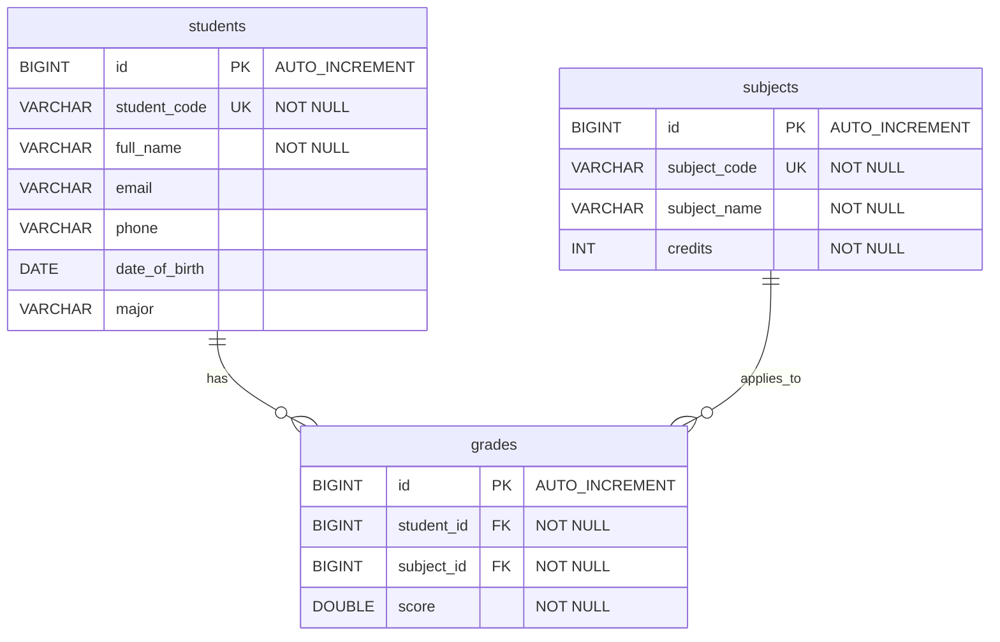

# Student Management System

A lightweight, premium console-based Java application designed to demonstrate backend development fundamentals. This project was built from scratch without utilizing high-level frameworks like Spring Boot or Spring Data JPA, focusing instead on Java Core, Object-Oriented Programming (OOP), Maven, and raw JPA/Hibernate with MySQL.

It is designed to serve as a strong portfolio project for **Java Backend Developer Intern** positions, showing a deep understanding of database persistence lifecycle, transaction management, relationships, and clean code principles.

---

## Features

- **Student Management (CRUD)**: Add, edit, delete, find by student code, and search by name.
- **Academic Course & Subject Management**: List and associate grades with courses.
- **Grade & GPA Management**:
  - Add, update, and delete academic grades.
  - Calculate **Weighted GPA** based on course credits:
    $$\text{GPA} = \frac{\sum (\text{Score} \times \text{Credits})}{\sum \text{Credits}}$$
  - Classify student performance based on standard academic regulations:
    - **GPA $\ge$ 8.5**: Excellent
    - **GPA $\ge$ 7.0**: Good
    - **GPA $\ge$ 5.0**: Average
    - **GPA $<$ 5.0**: Poor
- **Ranking Board**: Display all students sorted in descending order of their GPA.
- **Robust Exception Handling**: Custom exceptions (`StudentNotFoundException`, `DuplicateStudentException`, `InvalidScoreException`) to handle business logic errors gracefully without crashing the console loop.
- **Clean Configuration**: Utilizes an external `application.properties` configuration file (added to `.gitignore`) to load MySQL database credentials dynamically at runtime, avoiding hardcoding sensitive passwords in the codebase.

---

## Technologies

- **Java SE 17+** (Developed and tested with JDK 17/21/26)
- **Maven** (Dependency management & build tool)
- **JPA & Hibernate ORM 6.5.2.Final** (Object-Relational Mapping framework)
- **MySQL 8.0** (Relational Database)
- **MySQL Connector/J 8.3.0** (JDBC Driver)

---

## Architecture

The project implements a clean **Layered Architecture** appropriate for standalone Java SE applications. It separates concern into four distinct layers:

```
    User (Console CLI)
           ↓
       Main Menu
           ↓
     Service Layer  ← [Custom Exceptions]
           ↓
   Repository Layer
           ↓
     JPA/Hibernate (EntityManager & JpaUtil)
           ↓
      MySQL Database
```

1. **Main CLI Menu (`Main.java`)**: Handles console inputs and outputs using a `Scanner`. It remains clean of business logic and database queries.
2. **Service Layer (`StudentService`, `GradeService`, `SubjectService`)**: Implements business rules, validation, and GPA calculation.
3. **Repository Layer (`StudentRepository`, `GradeRepository`, `SubjectRepository`)**: Performs SQL/JPQL queries using a dedicated `EntityManager` instance per transaction to avoid resource leaks.
4. **Utility Layer (`JpaUtil.java`)**: Initializes and shuts down the `EntityManagerFactory`, overriding configurations using external file keys dynamically.

---

## Database Design



- **Student (1) --- (N) Grade**: Cascades operations on student deletion to clean up orphaned grades.
- **Subject (1) --- (N) Grade**: Cascades operations on subject deletion.
- **Grade (Join Entity)**: Represents the association with a unique constraint on `(student_id, subject_id)` ensuring a student has exactly one grade record per subject.

---

## Project Structure

```
src/main/
├── java/
│   └── com/
│       └── studentmanagement/
│           ├── entity/
│           │   ├── Grade.java
│           │   ├── Student.java
│           │   └── Subject.java
│           │
│           ├── repository/
│           │   ├── GradeRepository.java
│           │   ├── StudentRepository.java
│           │   └── SubjectRepository.java
│           │
│           ├── service/
│           │   ├── GradeService.java
│           │   ├── StudentService.java
│           │   └── SubjectService.java
│           │
│           ├── exception/
│           │   ├── DuplicateStudentException.java
│           │   ├── InvalidScoreException.java
│           │   └── StudentNotFoundException.java
│           │
│           ├── util/
│           │   └── JpaUtil.java
│           │
│           └── Main.java
│
└── resources/
    ├── META-INF/
    │   └── persistence.xml
    ├── application.properties.example
    └── application.properties (Created locally)
```

---

## Requirements

- **JDK 17 or higher**
- **Maven 3.6+** (or using the IntelliJ Maven bundle)
- **MySQL Server 8.0+**

---

## Installation & Running

### 1. Database Setup
Log in to your MySQL terminal and run the initialization script to create the database and tables along with some sample data:
```bash
mysql -u root -p < database/student_management.sql
```
*Alternatively, run the SQL code inside `database/student_management.sql` using any SQL client tool (e.g., MySQL Workbench, DBeaver, IntelliJ Database Tool).*

### 2. Configure Credentials
1. Go to the project resources folder: `src/main/resources/`.
2. Copy `application.properties.example` and name the new file `application.properties`.
3. Open `application.properties` and fill in your MySQL credentials:
```properties
db.url=jdbc:mysql://localhost:3306/student_management?useSSL=false&allowPublicKeyRetrieval=true&serverTimezone=UTC
db.username=root
db.password=123456
```

### 3. Build the Application
Open a terminal in the root folder of the project and compile it using Maven:
```bash
mvn clean package -DskipTests
```

### 4. Run the Application
Run the executable main class using Maven:
```bash
mvn exec:java
```

---

## Example Console Output

```text
=====================================
       STUDENT MANAGEMENT SYSTEM     
=====================================
1. Add student
2. Update student
3. Delete student
4. Find student by code
5. Search student by name
6. Display all students
7. Add grade
8. Update grade
9. Delete grade
10. View student GPA
11. Display ranking
0. Exit
=====================================
Choose an option: 11

--- Student Ranking (Sorted by GPA Descending) ---
+------+--------------+--------------------+--------------+--------+-------------+
| Rank | Code         | Name               | Major        | GPA    | Ranking     |
+------+--------------+--------------------+--------------+--------+-------------+
| 1    | SV002        | Tran Thi B         | Software ... | 8.50   | Excellent   |
| 2    | SV001        | Nguyen Van A       | Informat... | 8.23   | Good        |
| 3    | SV003        | Le Van C           | Data Sci... | 6.18   | Average     |
| 4    | SV004        | Pham Minh D        | Informat... | 4.57   | Poor        |
| 5    | SV005        | Hoang Thi E        | Computer... | 4.07   | Poor        |
+------+--------------+--------------------+--------------+--------+-------------+
```

---

## Learning Outcomes & Interview Tips

Building this project exercises critical software engineering practices highly relevant to interview questions:

1. **Transaction & Connection Management**: Under the hood of frameworks like Spring Boot, Hibernate transactions are handled manually. This project demonstrates knowledge of how to create an `EntityManager`, open transactions (`tx.begin()`), commit changes (`tx.commit()`), rollback on error (`tx.rollback()`), and close the connection properly in `finally` blocks to avoid connection pooling starvation.
2. **JPA Entity Association Mapping**: Shows correct implementation of `@OneToMany` and `@ManyToOne` fields. Explaining the use of `FetchType.LAZY` to avoid N+1 querying demonstrates optimization awareness.
3. **Hibernate Business Keys**: Implementing `equals()` and `hashCode()` based on a unique business identifier (`studentCode` / `subjectCode`) instead of the auto-generated database `id` ensures Set collection lookups work correctly before entities are persisted.
4. **Join Fetch Queries**: The JPQL query `"SELECT g FROM Grade g JOIN FETCH g.subject WHERE g.student.id = :studentId"` demonstrates knowledge of fetch-joins, preventing `LazyInitializationException` when accessing lazy relationships outside the transaction.
5. **Decoupled Architecture**: Clean separation of Console I/O from Business validation and Database transactions makes code highly maintainable and easily unit-testable.
